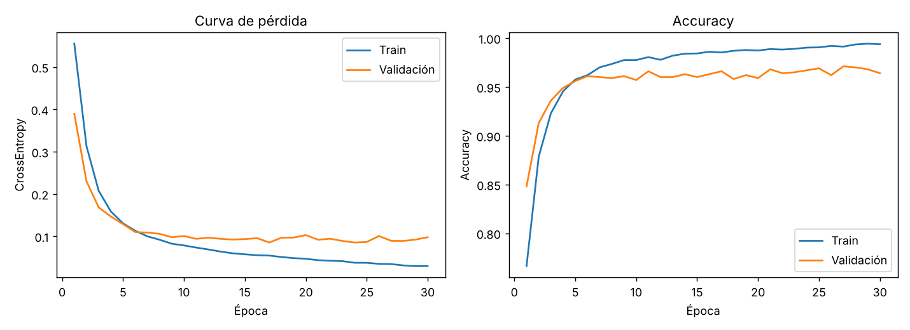

# Checkpoint 1 — Pipeline de entrenamiento, validación y clasificador base

Infraestructura inicial en PyTorch para el proyecto integrador: entorno reproducible, un MLP base, ciclo explícito de entrenamiento (forward → pérdida → backward → update) y ciclo de validación con registro de métricas por época.

## Estructura del repositorio

```
mi_proyecto_dl/
├── data/
│   └── synthetic_classification.csv   # dataset sintético generado (5000 x 20 + target)
├── notebooks/
│   └── pipeline_base.ipynb            # versión autocontenida y anotada del pipeline
├── src/
│   ├── utils.py                       # semillas y detección de dispositivo
│   ├── data.py                        # dataset, split estratificado y DataLoaders
│   ├── model.py                       # BaselineClassifier (nn.Module)
│   ├── engine.py                      # train_one_epoch() y evaluate()
│   └── train.py                       # script principal (CLI)
├── results/
│   ├── history.json                   # métricas por época
│   └── loss_curve.png                 # curvas de pérdida y accuracy
├── requirements.txt
└── README.md
```

## Cómo ejecutarlo

```bash
python -m venv .venv && source .venv/bin/activate   # en Windows: .venv\Scripts\activate
pip install -r requirements.txt
python -m src.train --epochs 30 --lr 0.001
```

Opciones: `--epochs`, `--lr`, `--batch-size`, `--seed`. También se puede abrir `notebooks/pipeline_base.ipynb`.

## Configuración técnica

| Elemento | Valor |
|---|---|
| Versión de PyTorch | **2.15.0** (la usada para generar los resultados de este README); `requirements.txt` pide `torch>=2.2.0` |
| Dispositivo | Detección automática CUDA > MPS > CPU (los resultados de abajo se corrieron en **CPU**) |
| Dataset | Sintético (`sklearn.make_classification`): 5000 muestras, 20 variables (15 informativas, 2 redundantes), 2 clases balanceadas |
| Partición | 80 % entrenamiento (4000) / 20 % validación (1000), estratificada, `seed=42` |
| Preprocesamiento | `StandardScaler` ajustado solo con train (sin data leakage) |
| Arquitectura | MLP: `Linear(20,64) → ReLU → Linear(64,32) → ReLU → Linear(32,2)` (3490 parámetros) |
| Pérdida | `nn.CrossEntropyLoss` |
| Optimizador | Adam (`torch.optim.Adam`) |
| **Learning rate** | **`0.001`** |
| Batch size / Épocas | 64 / 30 |
| Métricas | Loss y accuracy (train y validación) y F1-score (validación), por época |

**Por qué `learning_rate = 0.001`:** es el valor por defecto de Adam y un punto de partida habitual para MLPs pequeños con datos estandarizados. No se hizo búsqueda de hiperparámetros: el objetivo de este checkpoint es la calidad del pipeline, no el ajuste fino.

## Resultados



| Época | Train loss | Val loss | Val accuracy |
|---:|---:|---:|---:|
| 1 | 0.5551 | 0.3892 | 84.80 % |
| 5 | 0.1305 | 0.1287 | 95.60 % |
| 10 | 0.0784 | 0.1006 | 95.70 % |
| 20 | 0.0469 | 0.1027 | 95.90 % |
| 30 | 0.0297 | 0.0977 | 96.40 % |

- Mejor pérdida de validación: **0.0852** (época 24).
- Mejor accuracy de validación: **97.10 %** (época 27); F1 de validación en esa época: 0.9711.
- Última época: train accuracy 99.38 % vs. validación 96.40 % (brecha de ~3 puntos).

## Interpretación de la curva de pérdida

**Sí, la pérdida bajó.** La pérdida de entrenamiento cae de forma sostenida de 0.555 a 0.030 en las 30 épocas, lo que confirma que el ciclo `zero_grad() → forward → loss.backward() → optimizer.step()` está funcionando y que `autograd` propaga bien los gradientes.

La pérdida de validación baja junto con la de entrenamiento hasta aproximadamente la época 6 (≈ 0.11). A partir de ahí se aplana y oscila entre ~0.085 y ~0.10, mientras que la de entrenamiento sigue bajando. Esa separación entre ambas curvas, junto con la brecha de accuracy (99.4 % vs. 96.4 %), indica **un sobreajuste leve**: el modelo empieza a memorizar train sin ganar capacidad de generalización. No es grave, porque la pérdida de validación no sube de forma sostenida, pero sugiere que más épocas no aportarían y que habría que usar early stopping o regularización (dropout, weight decay) en los próximos checkpoints. La fluctuación de la validación entre épocas es esperable con solo 1000 muestras de validación.

## Reproducibilidad

Se fijan las semillas de `random`, `numpy` y `torch` (y CUDA si está disponible), y el `shuffle` del `DataLoader` usa un `Generator` con semilla. En CPU, dos corridas con la misma configuración dan los mismos resultados. En GPU o con otra versión de PyTorch los números pueden variar ligeramente; si corrés el pipeline en tu entorno, actualizá la versión y la tabla de resultados con lo que obtengas.

## Errores comunes que el código evita

- **Gradientes acumulados:** `optimizer.zero_grad()` se llama en cada iteración, antes del `forward`.
- **Inconsistencia de dispositivos:** modelo, entradas y etiquetas pasan por `.to(device)`.
- **Data leakage:** el escalado se ajusta solo con train.
- **Evaluación con grafo de gradientes:** `evaluate()` usa `@torch.no_grad()` y `model.eval()`.
